### About me

I'm a CS student at Sri Siddhartha Institute of Technology in Tumakuru, graduating in 2028. Most of what I build is backend-heavy with some ML mixed in, and I care a lot about getting the whole thing working end to end, not just one piece of it.

I'm also the AI/ML Tech Lead at QARC, our college's Quantum AI and Research Cell. Right now I'm looking for software engineering internships for Summer 2027. More about me on my [portfolio](https://karan-tej.pages.dev/).

### Things I've built

| Project | What it does | Built with |
|---|---|---|
| [Risk Engine](https://github.com/KaranTej27/Risk-Engine-) | Measures how risky a stock or portfolio is (VaR, CVaR, volatility, drawdown, Sharpe, Sortino) and shows it on a dashboard | Python, TypeScript, Next.js |
| [AI SOC Analyst](https://github.com/KaranTej27/AI-soc-analyst) | Reads raw server logs, groups activity per IP into 5-minute windows, and flags anything unusual with Isolation Forest, scored 0 to 100 | Python, FastAPI, scikit-learn |
| [Neural Linguistic Bridge](https://github.com/KaranTej27/neural-linguistic-bridge-) | Reads EEG signals through an ESP32 and looks for the N400, the brain's reaction to a word that doesn't fit | ESP32, Python, PyQtGraph, Gemma 2B |
| [StudentSphere](https://github.com/KaranTej27/StudentSphere) | One place for a student's timetable, goals, homework, AI-generated quizzes and progress tracking | Flask, Firebase |
| [ECHO](https://github.com/KaranTej27/ECC-Analyzer) | Landing page for an idea I had: turning earnings calls into market insights | TypeScript |

### What I'm working on now

An AI agent that watches a Kubernetes cluster, figures out what broke, and fixes it. I'm building it with a friend and it's still early.

### Tools I use

  

Learning right now: Kubernetes

### Outside of code

- 2nd place at Code Buzz, a DSA competition at my college
- Won an Arduino workshop competition
- Helping run National Quantum Fest 2026 at SSIT

### My contributions, eaten by a snake

<picture>
  <source media="(prefers-color-scheme: dark)" srcset="https://raw.githubusercontent.com/KaranTej27/KaranTej27/output/github-snake-dark.svg" />
  <source media="(prefers-color-scheme: light)" srcset="https://raw.githubusercontent.com/KaranTej27/KaranTej27/output/github-snake.svg" />
  
</picture>

